# DeutschCraft

> **An offline-first Android German-learning app where conversation is the learning interface.**

DeutschCraft is a native Android application built with **Kotlin and Jetpack Compose** that helps learners improve their German through natural AI conversations.

Instead of organizing learning around lessons and quizzes, DeutschCraft makes conversation the primary experience. While the learner chats with **Emil**, a persistent AI companion, the application evaluates language ability, provides contextual corrections, tracks CEFR progress, adapts learning support, and introduces real-world conversation missions in the background.

```text
Conversation → Assessment → Feedback → Adaptation → Progress
```

### Highlights

- 💬 **Natural AI conversation** with a persistent German-speaking companion
- ✨ **Contextual corrections** through the Besser learning system
- 🎯 **Conversation-driven missions** with objectives completed through natural dialogue
- 📈 **Evidence-based CEFR progression** from A1 to C2
- 🧠 **Adaptive learning** based on observed strengths, weaknesses, and vocabulary
- 📱 **Offline-first architecture** with Room as the operational source of truth
- 🔄 **Background cloud synchronization** with WorkManager
- ☁️ **Authenticated cross-device infrastructure** using AWS
- 🔐 **Google sign-in and authentication** through Amazon Cognito
- 🤖 **Secure Qwen integration** through API Gateway and AWS Lambda

> **Conversation first. Learning happens naturally.**

---
## DeutschCraft in Action

DeutschCraft combines a messaging-first interface with contextual language coaching, adaptive learning, real-world missions, and evidence-based progress tracking.

### Conversation & Learning

<p align="center">
  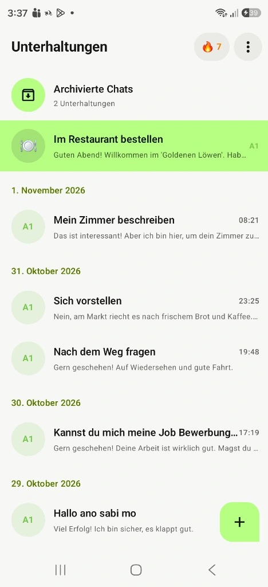
  &nbsp;&nbsp;
  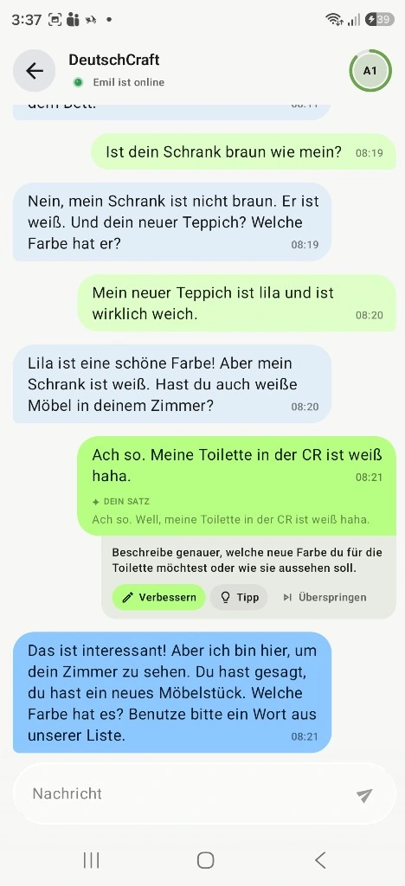
  &nbsp;&nbsp;
  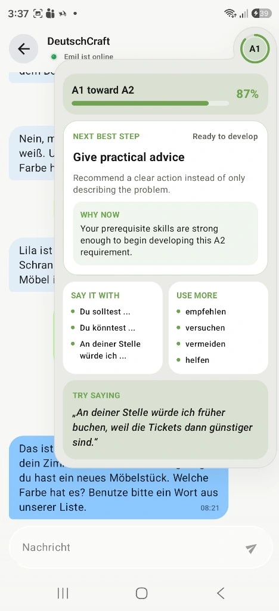
</p>

<p align="center">
  <sub>
    Conversation threads &nbsp;&nbsp;•&nbsp;&nbsp;
    Contextual Besser corrections &nbsp;&nbsp;•&nbsp;&nbsp;
    Adaptive learning guidance
  </sub>
</p>

### Missions & Progress

<p align="center">
  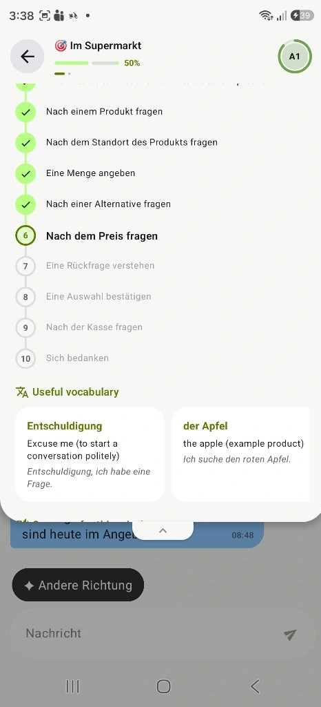
  &nbsp;&nbsp;
  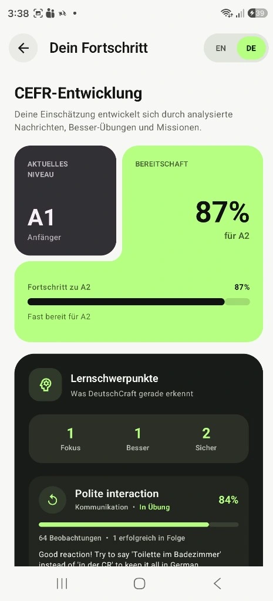
  &nbsp;&nbsp;
  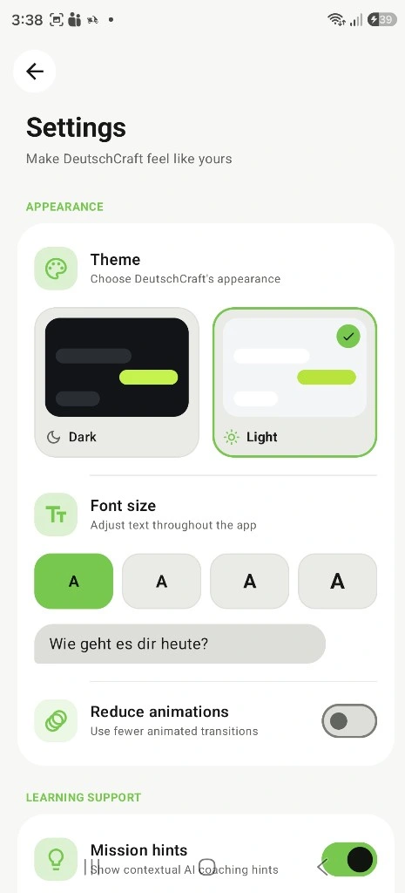
</p>

<p align="center">
  <sub>
    Conversation-driven missions &nbsp;&nbsp;•&nbsp;&nbsp;
    CEFR progression &nbsp;&nbsp;•&nbsp;&nbsp;
    Personalization & accessibility
  </sub>
</p>

### Authentication

<p align="center">
  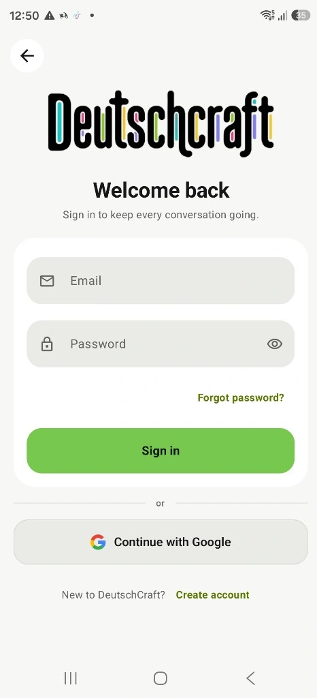
</p>

<p align="center">
  <sub>Authenticated accounts with Google sign-in and Amazon Cognito</sub>
</p>

---
# What DeutschCraft Does

DeutschCraft turns everyday German conversation into an adaptive learning experience. Instead of moving through predefined lessons, learners communicate naturally while the application observes language use, provides contextual support, and adapts what comes next.

<p align="center">
  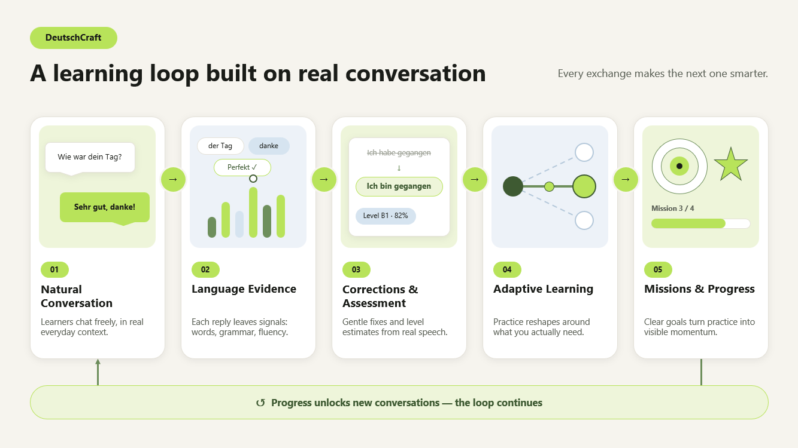
</p>

## One Conversation, Multiple Learning Systems

A conversation is more than a sequence of messages. The same interaction can generate corrections, CEFR evidence, mission progress, and vocabulary learning without requiring the learner to leave the chat.

<p align="center">
  
</p>

### Learning happens inside the conversation

- **Besser** provides contextual corrections and refinement challenges.
- **Missions** turn real-world scenarios into conversational objectives.
- **CEFR assessment** builds proficiency evidence from observed language use.
- **Vocabulary learning** emerges from words and phrases encountered during communication.

## Adaptive by Design

DeutschCraft uses accumulated learning evidence to influence what the learner should practice next.

<p align="center">
  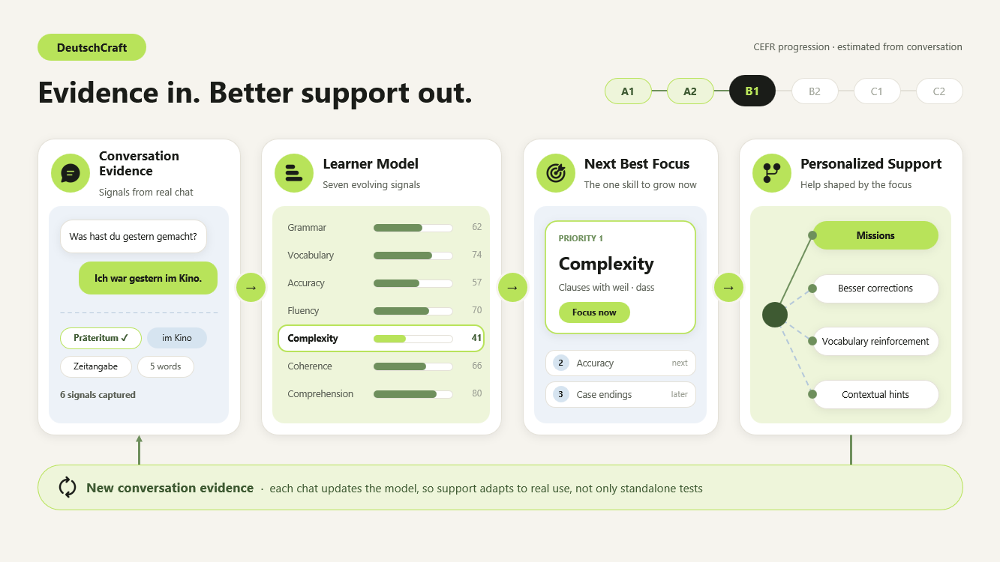
</p>

Rather than forcing every learner through the same sequence, DeutschCraft can use observed strengths, weaknesses, vocabulary familiarity, mission performance, and CEFR evidence to shape future support.

> **The learner focuses on communicating. DeutschCraft handles the learning system around the conversation.**

---

# Engineering Highlights

DeutschCraft was designed as more than an AI chat interface. The application combines offline-first Android architecture, reactive local persistence, authenticated cloud infrastructure, background synchronization, and secure AI access while keeping the conversation experience responsive and resilient.

## Offline-First by Default

**Room is the operational source of truth.**

User actions are committed locally before cloud synchronization is requested, allowing conversations, missions, progress, and learning history to remain available even when the backend is temporarily unreachable.

```text
User Action
    ↓
Repository
    ↓
Room
    ↓
Flow / StateFlow
    ↓
Compose UI
    ↓
Background Sync
```

This keeps network availability out of the critical path for normal local interactions.

## Resilient Cloud Synchronization

DeutschCraft uses **WorkManager** to synchronize supported local state with AWS without replacing Room's role as the local data authority.

The synchronization system includes:

- Immediate sync after supported local mutations
- Periodic background synchronization
- Incremental downloads using a synchronization cursor
- Upload batching of up to 100 changes per request
- Independent batch acknowledgement
- Local dirty-state protection
- Tombstone-based deletion
- Mission snapshot synchronization
- Cross-device restoration infrastructure

A failed network operation does not undo an already committed local change.

## Secure AI & Authentication

AI provider credentials are never stored inside the Android application.

Authenticated requests follow a protected backend path:

```text
Android
   ↓
Amazon Cognito
   ↓
JWT
   ↓
Amazon API Gateway
   ↓
AWS Lambda
   ├── Qwen
   └── Amazon DynamoDB
```

Google sign-in integrates with the Cognito authentication flow, while cloud ownership is derived from the authenticated Cognito identity rather than an arbitrary user identifier supplied by the client.

## Reactive Android Architecture

Application state flows from persistence toward the UI through repositories and ViewModels:

```text
Room
  ↓
DAO
  ↓
Repository
  ↓
Flow / StateFlow
  ↓
ViewModel
  ↓
Jetpack Compose
```

This architecture keeps persisted learner state observable and allows Compose screens to react naturally to changes in conversations, mission progress, assessments, and other locally stored state.

## Stateful Mission Synchronization

Missions are more complex than individual chat messages because a mission can contain generated templates, objectives, objective progress, branching state, and completion state.

DeutschCraft therefore synchronizes missions as self-contained snapshots containing the information required to reconstruct their current state on another device.

```text
Conversation Mission
        +
Mission Template
        +
Objectives
        +
Objective Progress
        ↓
Cloud Mission Snapshot
```

This provides the foundation for continuing generated and partially completed learning missions across devices.

---

# Engineering Highlights

DeutschCraft was designed as more than an AI chat interface. The application combines offline-first Android architecture, reactive local persistence, authenticated cloud infrastructure, background synchronization, and secure AI access while keeping the conversation experience responsive and resilient.

## System Architecture

<p align="center">
  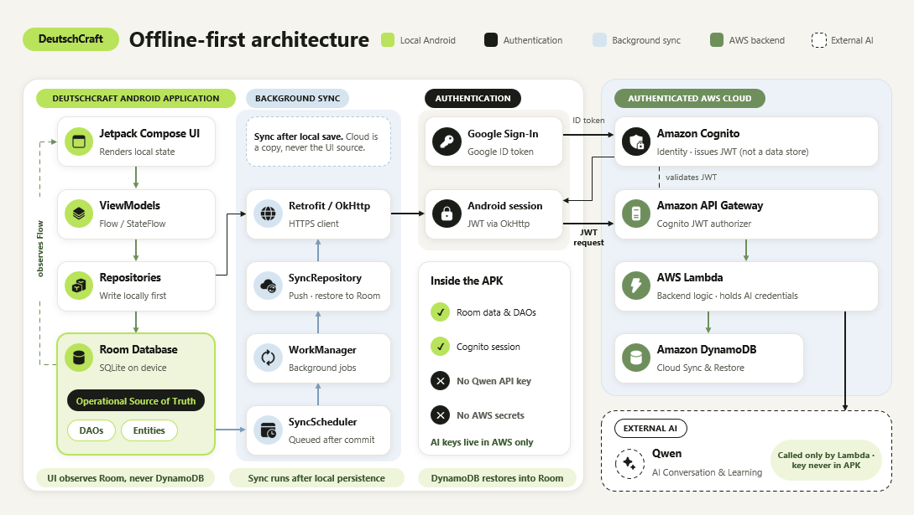
</p>

At the center of DeutschCraft's architecture is a simple principle:

> **Local persistence owns the user experience. Cloud infrastructure provides continuity.**

Room remains the operational source of truth on Android. Compose observes reactive local state through repositories and ViewModels, while WorkManager independently coordinates authenticated synchronization with AWS.

AI requests follow a protected backend path through Amazon Cognito, API Gateway, and Lambda, keeping Qwen provider credentials outside the Android application.

---

## Conversation-Driven Mission Architecture

DeutschCraft missions are persistent learning experiences rather than standalone exercises. Objectives are completed through evidence detected in the conversation while contextual support remains available without removing the learner from the chat.

<p align="center">
  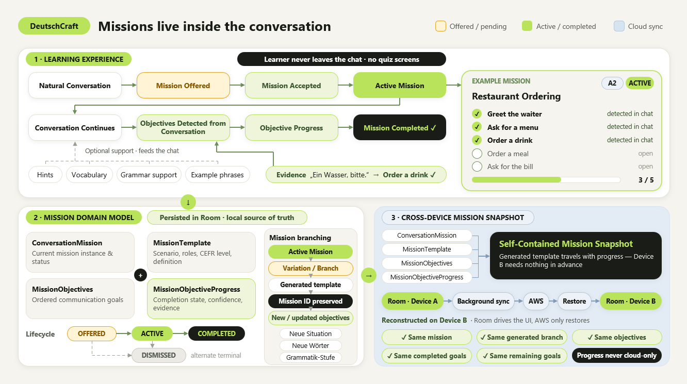
</p>

### Missions are stateful

A mission combines several related pieces of domain state:

- **ConversationMission** tracks the active mission instance and lifecycle.
- **MissionTemplate** defines the scenario, roles, CEFR difficulty, and learning context.
- **MissionObjectives** define the communication goals.
- **MissionObjectiveProgress** records completion, confidence, and supporting evidence.

Mission states can progress from `OFFERED` to `ACTIVE` and eventually `COMPLETED`, while dismissed missions retain their own lifecycle state.

### Generated missions can evolve

Active missions can branch into new situations, vocabulary focuses, or grammar challenges. Generated branches can introduce new mission templates and objectives while preserving the identity of the existing conversation mission.

This allows the learning scenario to evolve without discarding already completed progress.

### Mission snapshots support continuity

Mission synchronization packages the current mission definition, objectives, and objective progress into a self-contained snapshot.

This means another device can reconstruct a generated or branched mission without assuming that the same generated template already exists locally.

> **The conversation drives the mission. The mission state survives beyond the conversation session.**

---
# Technology Stack

DeutschCraft combines native Android development with an offline-first persistence layer, background synchronization, authenticated AWS infrastructure, and AI-powered language services.

| Area | Technologies |
|---|---|
| **Android** | Kotlin · Jetpack Compose · Material 3 · Navigation Compose · ViewModel |
| **Architecture & State** | Repository Pattern · Coroutines · Flow · StateFlow |
| **Local Data** | Room · DataStore · Explicit Room Migrations |
| **Dependency Injection** | Hilt · Hilt WorkManager |
| **Background Work** | WorkManager |
| **Networking** | Retrofit · OkHttp · Kotlin Serialization |
| **Authentication** | Google Sign-In · Amazon Cognito · JWT |
| **AWS** | API Gateway · Lambda · DynamoDB · CloudWatch |
| **AI** | Qwen |
| **Cloud Data Strategy** | Incremental Sync · Upload Batching · Tombstones · Mission Snapshots |

# Key Engineering Decisions

DeutschCraft's architecture is shaped by a small set of principles intended to keep the application responsive, resilient, secure, and maintainable as the learning model grows.

## 1. Room Owns the Local Experience

DeutschCraft does not require a successful cloud request before committing normal user activity.

```text
Write Locally
     ↓
Commit to Room
     ↓
Update Reactive UI
     ↓
Request Background Sync

# Project Structure DeutschCraft uses a **feature-oriented package structure** so product domains can evolve independently while shared Android infrastructure remains centralized under `core`. <p align="center"> 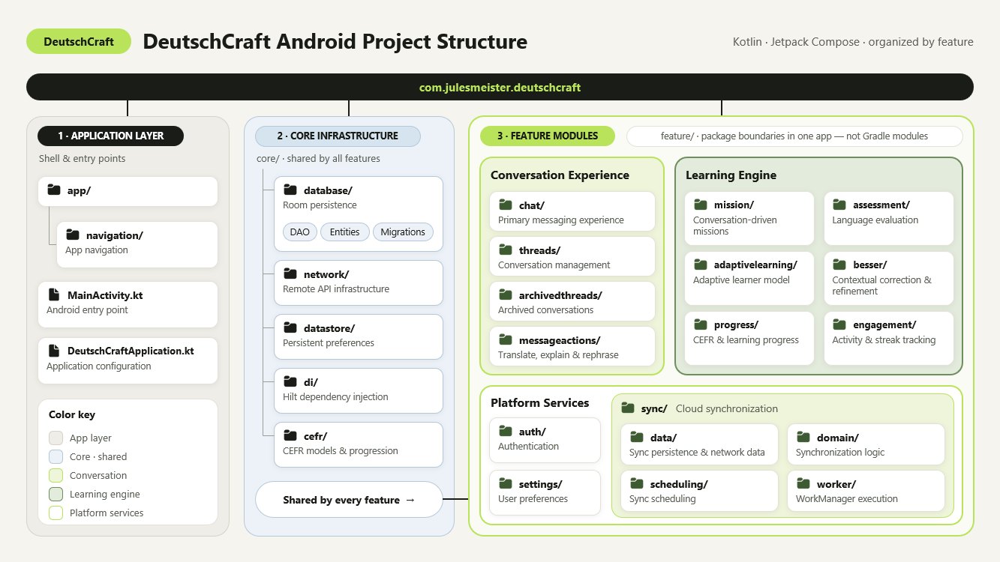 </p> The codebase is organized around three primary areas: - **`app`** coordinates application-level concerns such as navigation. - **`core`** contains shared infrastructure including Room, networking, DataStore, dependency injection, and CEFR foundations. - **`feature`** contains product domains such as conversation, missions, assessment, Besser, adaptive learning, progress, authentication, and synchronization. The synchronization feature is further separated into data, domain, scheduling, and worker responsibilities because background cloud synchronization spans persistence, networking, scheduling, and WorkManager execution. > **Shared infrastructure lives in `core`; product behavior stays close to the feature that owns it.**

---

# Project Status

DeutschCraft is an actively developed portfolio project. Its core conversation, learning, persistence, authentication, and cloud foundations are implemented, while cross-device learner continuity continues to expand.

## ✅ Implemented

### Conversation Experience

- Natural AI conversations with Emil
- Multiple persistent conversation threads
- Automatic conversation titles
- Archive and restore
- Contextual Besser corrections
- Reply suggestions
- Translate, explain, and rephrase actions
- Typing and message animations
- Dark and light themes
- Keyboard-aware Compose UI

### Learning System

- CEFR assessment from A1 to C2
- Evidence-based skill tracking
- Adaptive-learning foundation
- Besser correction and refinement system
- Conversation-driven missions
- Mission objectives and progress tracking
- Mission branching and variation flows
- Contextual hints, vocabulary, grammar, and example phrases
- Progress dashboard
- Activity and learning-history tracking

### Android Architecture

- Kotlin and Jetpack Compose
- Room persistence with explicit migrations
- Repository-based data access
- Flow and StateFlow reactive state
- Hilt dependency injection
- DataStore settings
- WorkManager background processing
- Retrofit and OkHttp networking

### Authentication & Backend

- Google sign-in
- Amazon Cognito authentication
- JWT-protected AWS APIs
- Amazon API Gateway
- AWS Lambda backend
- Qwen provider isolation from the Android APK
- Amazon DynamoDB cloud persistence

### Cloud Synchronization

- Conversation synchronization
- Message synchronization
- Mission synchronization
- Incremental downloads using synchronization cursors
- Batched uploads
- Per-batch acknowledgement
- Immediate synchronization after supported mutations
- Periodic WorkManager synchronization
- Archive and restore synchronization
- Deletion tombstones
- Mission template snapshots
- Mission objective snapshots
- Mission progress snapshots
- Cognito-based per-user cloud ownership

---

## 🚧 Current Focus

### Cross-Device Mission Continuity

The current engineering milestone is validating complete mission continuity across devices.

```text
Device A
   ↓
Start Mission
   ↓
Complete Objectives
   ↓
Background Sync
   ↓
AWS
   ↓
Device B
   ↓
Restore Same Mission
   ↓
Continue Progress
   ↓
Sync
   ↓
Device A Receives Updated State
```

The remaining verification focuses on:

- Fresh-device active mission restoration
- Partially completed mission continuation
- Generated mission-branch reconstruction
- Objective-progress convergence between devices
- `COMPLETED` state convergence
- `DISMISSED` state convergence
- Mission recommendation and completion identity

The goal is not merely cloud backup. A learner should be able to **continue the same learning experience on another authenticated device without losing mission context or completed objectives.**

---

## 🧭 Planned Expansion

Once mission continuity is reliable, synchronization can expand to the broader learner model.

### Learner Continuity

- Learner profile
- CEFR progress state
- Assessment evidence
- Activity and streak data
- Adaptive-learning evidence
- Besser mastery state
- Marked phrases
- Appropriate user settings

### Learning Experience

- Vocabulary mastery tracking
- Weak-vocabulary reinforcement
- Mission review experience
- Mission difficulty progression
- Improved adaptive mission selection

### Language & Audio

- Speech playback
- Pronunciation practice
- Shadowing
- Listening-focused missions

### Account Experience

- Email authentication
- Account management
- User-data deletion flows

---

> **Current priority:** reliable cross-device mission continuity while preserving DeutschCraft's offline-first architecture and Room's role as the operational source of truth.

---